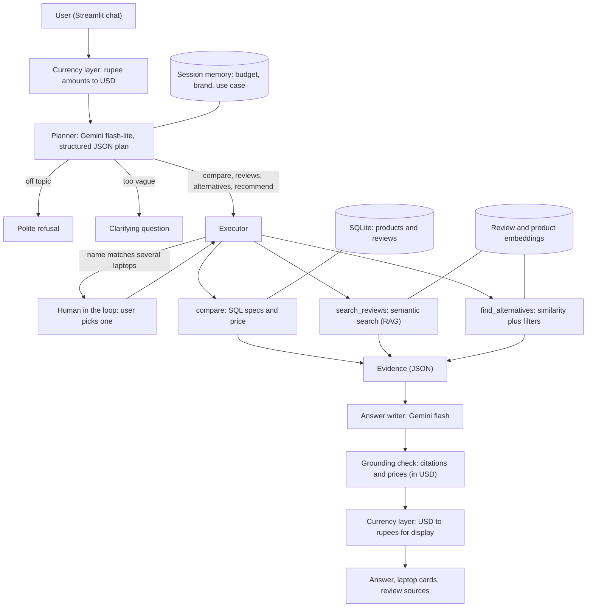

# Laptop Shopping Assistant

An AI shopping assistant that helps people choose a laptop: it **compares** models, **reads what real customers say**, and **finds alternatives** that match a budget and a use case. Every price and every quoted review in an answer is checked against the data before it reaches the user.

- **Live app:** https://ai-shopping-assistant-26.streamlit.app/
- **Category:** gaming laptops (80 products, about 3,200 customer reviews)

## What it can do

| Need | How the assistant handles it |
|---|---|
| **Compare products** | Pulls specs and price from a SQL database, adds review evidence for the user's stated priorities (for example "fan noise"), and writes a short verdict |
| **Recommend from reviews** | Filters by budget and brand, ranks by customer review stars, and quotes the reviews that talk about the user's use case |
| **Discover alternatives** | Finds similar laptops with embedding similarity, applies the budget, and explains how each one differs ("₹28,500 cheaper", "less RAM", "different GPU") |
| **Extra: memory** | Remembers budget, brand and use case during a conversation and shows them in the sidebar |

## Architecture



### How a question flows
1. **Currency layer (input).** Rupee amounts in the user's message are converted to US dollars at a fixed rate, so the planner and tools work on the same currency as the data.
2. **Planner (cheap model).** Turns the message into a validated JSON plan (`intent`, product names, aspects, budget, brand, use case). It also decides when a question is off-topic or too vague.
3. **Executor.** Runs the right tools from the plan. If a product name matches several laptops, it stops and asks the user which one they mean instead of guessing.
4. **Tools.** `compare` (SQL), `search_reviews` (semantic search over review embeddings) and `find_alternatives` (embedding similarity with budget, rating and duplicate-listing filters).
5. **Answer writer (stronger model).** Writes the reply using **only** the evidence JSON and cites reviews as `[R123]`.
6. **Grounding check.** Verifies that every cited review exists in the evidence and every dollar amount appears in it. Unverified claims are flagged to the user.
7. **Currency layer (output).** After verification, dollar amounts in the answer text, laptop cards, spec table, preference chips and shortlist are converted to rupees for display.

## Design decisions

| Decision | Why |
|---|---|
| **Model routing** | A cheap, fast model plans; a stronger model writes. Planning takes about 1 second and saves quota for the answer step. |
| **Automatic model fallback and caching** | Each step has an ordered list of models. If one is out of free quota or slow (40 s timeout, no hidden retries), the next is tried. Identical prompts are answered from an in-memory cache. |
| **Structured outputs** | The planner returns a Pydantic-validated schema, so the code never parses free text. |
| **Retrieval without a vector database** | With 80 products and about 3,200 reviews, brute-force cosine similarity over a NumPy array takes milliseconds and adds no extra service to host. A vector database would be the next step at larger scale. |
| **Light embeddings at deploy time** | The index was built with `sentence-transformers` (all-MiniLM-L6-v2). The deployed app embeds queries with `fastembed` (ONNX, same model, no PyTorch) so it fits on a free host. A check script confirms the vectors match. |
| **Currency conversion only in the interface layer** | The data, the tools and the grounding check all stay in US dollars, so verification is exact and no stored value is changed. The conversion rate is one constant (`USD_TO_INR`, currently 95) in `app.py`. It is a fixed rate, not a live one, which keeps the app free of another external service. |
| **Guardrails** | Off-topic questions are refused without calling the tools; missing specs are reported as "not available" instead of guessed; every citation and price is verified. |
| **Human in the loop** | Ambiguous product names and vague questions trigger a clarifying step. |
| **Honest data handling** | Specs are extracted from product titles with regular expressions and left empty when not found. |

## Evaluation

Run with `python eval/run_eval.py` (results in `eval/results.md`).

| Check | Result |
|---|---|
| Review retrieval: relevant reviews in the top 5 (keyword proxy, 8 topics) | **78%** precision@5; **100%** of topics returned at least one relevant review |
| Tool rules (budget respected, brand filter, no self or duplicate alternatives, unknown product gives an error, ambiguous name asks the user) | **13 / 13** passed |
| Planner: correct intent, budget, brand and aspects (12 hand-written questions) | **12 / 12**, average 1.3 s |
| Full answers: every citation and price matches the data (3 end-to-end questions) | **3 / 3** grounded, 3.0 review citations per answer on average, 10.2 s end to end |


## Limitations

- **Prices are US dollars from Amazon US listings, shown in rupees at a fixed rate.** The rate is ₹95 per dollar, set in `app.py`, and is not a live exchange rate. Prices are also a snapshot in time and differ from what Indian stores charge, so treat the rupee figures as a guide.
- **Memory lasts one visit.** Preferences and the shortlist are kept during a session, not across visits.
- **Free-tier AI quota.** The app uses Gemini's free tier; if every model is out of quota, it says so instead of failing silently.

## Run it locally

```bash
git clone https://github.com/Noorulhasna27/AI-shopping-assistant.git
cd AI-shopping-assistant
python -m venv venv && source venv/bin/activate      # Windows: venv\Scripts\activate
pip install -r requirements.txt
echo "GEMINI_API_KEY=your-key" > .env
streamlit run app.py
```

To rebuild the data from scratch (needs `pip install datasets huggingface_hub pyarrow sentence-transformers`):

```bash
python src/ingest/build_dataset.py     # reviews and metadata -> data/raw/
python src/ingest/build_db.py          # clean, extract specs -> data/shop.db
python src/ingest/build_embeddings.py  # embeddings -> data/*.npy
```

## Project structure

```
app.py                  Streamlit interface, rupee conversion, shortlist
src/agent/              planner, executor, answer writer, grounding check, model fallback
src/tools/shop_tools.py compare, search_reviews, find_alternatives
src/ingest/             dataset download, cleaning, spec extraction, embeddings
data/                   SQLite database and embeddings
eval/                   evaluation script and results
```

## Data and credits

Product metadata and reviews come from **Amazon Reviews 2023** (McAuley Lab, University of California San Diego). The laptop review subset was taken from the Hugging Face dataset `naga-jay/amazon-laptop-gpu-reviews`, and product metadata from the McAuley Lab dataset. Used for this assessment only.

